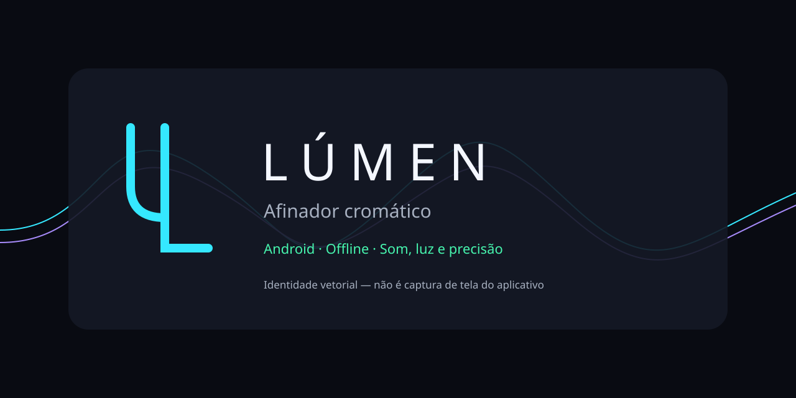

# Lúmen — Afinador cromático

Aplicativo Android nativo em Kotlin e Jetpack Compose. Analisa áudio no aparelho: afinador monofônico, espectro FFT e ressonâncias de bateria em modo experimental. Sem anúncios, contas, rastreamento, gravação de áudio ou permissão de Internet.



Referência Lá4 entre 400 e 480 Hz, em passos de 0,1 Hz; temperamento igual; notas internacionais e equivalentes em português, oitavas científicas, sustenidos/bemóis, alvo automático com histerese ou alvo manual por nota/oitava/Hz. Presets de violão e baixo fixam alvos somente por seleção explícita. A nota detectada não é remapeada às cordas.

Interface escura em português, cores próprias para as 12 notas, Hz/cents/dBFS, confiança, saturação e barra ±50 cents. Cents negativos: **Apertar**; positivos: **Afrouxar**; centro: **Afinado**, com tolerância configurável de ±3 cents inicialmente. Sinal ambíguo não recebe instrução mecânica.

## Estado da entrega

Código Android implementado, mas **build Android ainda sem sucesso, sem APK ou testes em aparelho**: a tentativa de build falhou ao resolver plugins com a JRE 8 disponível; não há SDK Android/JDK 17 no ambiente. O DSP Kotlin de produção foi compilado e testado na JVM local: 155 verificações passaram; 22 senoides em 44,1/48 kHz, pior erro limpo 0,00563 cent e zero erros de oitava nesse conjunto. Isso não comprova desempenho no microfone de um telefone. Consulte [TESTING](docs/TESTING.md) para limites da amostra e resultados atualizados.

## Compilar e instalar

Pré-requisitos: JDK 17, Android SDK com `platforms;android-35`, `build-tools;35.0.0` e platform-tools. Configure `JAVA_HOME` e `ANDROID_HOME` no seu ambiente, ou selecione o JDK 17 e SDK pelo Android Studio. Não versionar `local.properties`. Gradle Wrapper 8.11.1 incluído; dependências fixadas, sem exigir instalação global do Gradle. A primeira compilação precisa de rede para baixar ferramentas/dependências; o aplicativo funciona offline.

PowerShell, na raiz:

```powershell
.\gradlew.bat -PdspOnly :dsp:verifyDsp
.\gradlew.bat :app:assembleDebug :app:lintDebug
adb install -r app/build/outputs/apk/debug/app-debug.apk
adb shell am start -n br.com.lumen/.MainActivity
```

Linux/macOS: `sh ./gradlew -PdspOnly :dsp:verifyDsp` e `sh ./gradlew :app:assembleDebug :app:lintDebug`. O APK só existirá após build bem-sucedido. Para repetir os testes locais com a JVM 8, veja a alternativa independente em [TESTING](docs/TESTING.md).

Ao abrir, permita o microfone. Se negar, use o botão de permissões do aplicativo. A captura pausa ao sair da Activity e é liberada; retoma ao voltar quando autorizada. Não há serviço de microfone em segundo plano. Use Pausar/Retomar para recuperar uma entrada interrompida.

## Como interpretar

- **Afinador:** toque uma corda de cada vez. O número principal é a nota medida; o alvo manual fica separado. A barra não transforma erros de mais de 50 cents em outra nota.
- **Espectro:** FFT medida, eixo logarítmico de 20 Hz a 5 kHz ou Nyquist, lista de picos, congelamento e retenção com decaimento. As amplitudes do gráfico são dB relativos ao máximo do quadro; não são o RMS dBFS. O marcador rosa é f₀ monofônico, separado dos máximos medidos. Não reconhece acordes.
- **Bateria experimental:** escolha Pele/parafuso ou Som global, toque, aguarde a janela pós-ataque e selecione a ressonância pretendida. Compare frequências e repetições, sem presumir que o pico mais forte seja a fundamental. Não há alvos universais para tambores.

dBFS é nível digital RMS, com piso de −120 dBFS; **não é dB SPL**. 20–2000 Hz é o intervalo de estimativa do detector; 20 Hz não é sensibilidade comprovada do hardware. Microfones, processamento do fabricante, ruído e latência limitam o resultado. Graves usam janela de até 32768 amostras (683 ms a 48 kHz; 743 ms a 44,1 kHz), além da latência de captura. Não há promessa de precisão física universal.

## Estrutura e documentação

`app/`: captura, estado persistente, interface e recursos Android. `dsp/`: matemática musical, FFT, MPM e bateria sem dependências Android. `assets/`: fontes vetoriais originais. `scripts/`: verificação local. `.github/workflows/`: CI preparada, ainda não executada remotamente.

[Arquitetura](docs/ARCHITECTURE.md) · [DSP](docs/DSP.md) · [Design](docs/DESIGN.md) · [Testes](docs/TESTING.md) · [Privacidade](docs/PRIVACY.md) · [Limitações](docs/LIMITATIONS.md) · [Decisões e fontes](docs/DECISIONS.md) · [Dependências](THIRD_PARTY_NOTICES.md)

Próximas etapas: build e lint com SDK, teste de captura/lifecycle/acessibilidade no Samsung M55 ou outro Android, corpus de gravações reais, desempenho térmico, revisão dos limiares de ambiguidade e experiência visual no dispositivo. Fontes ampliadas e TalkBack precisam de validação instrumental. Não há screenshots de produção nesta entrega.

## Licença

Recomenda-se MIT ou Apache-2.0 para o código original, a decidir pelo titular. Nenhuma licença do projeto nem identidade de proprietário foi declarada. Dependências e Gradle Wrapper mantêm suas próprias licenças. Nenhum commit, stage, push ou publicação foi realizado.
